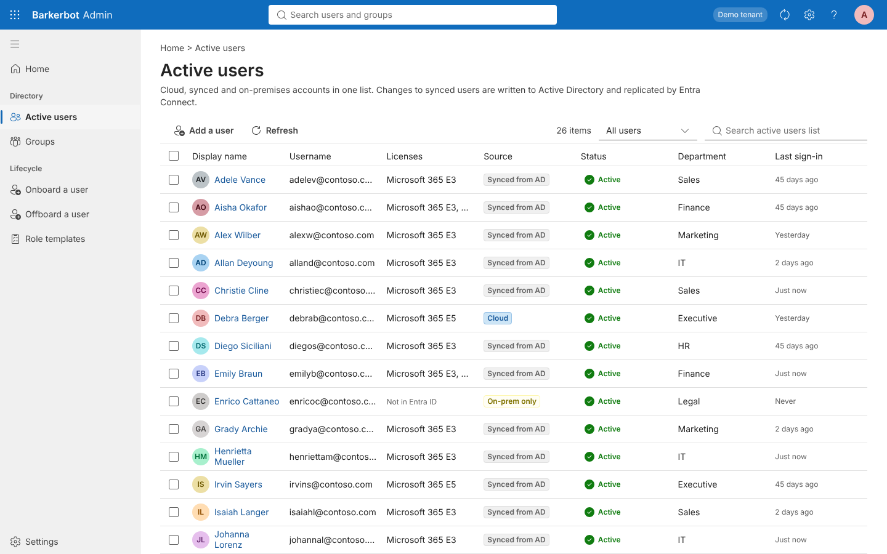
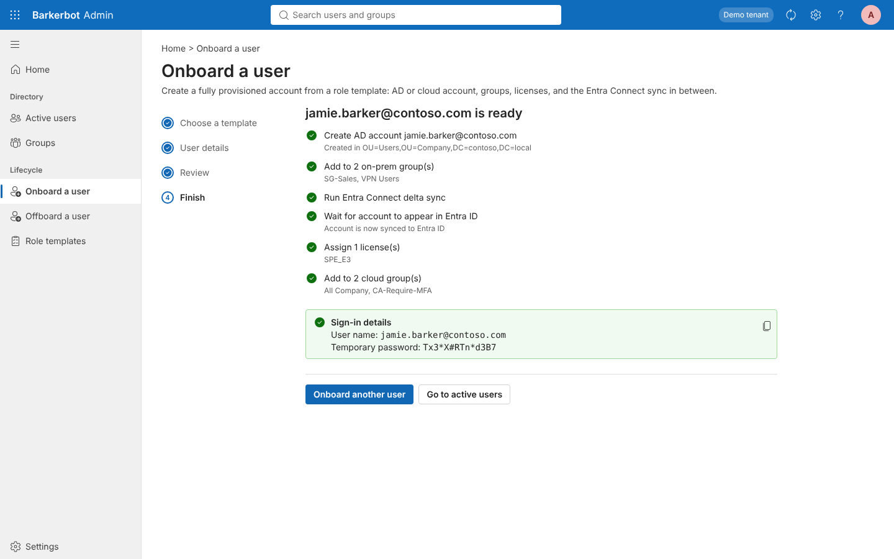
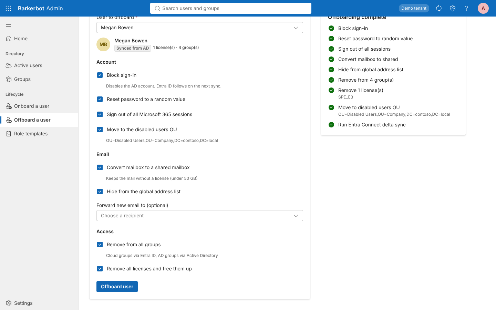

# Barkerbot Admin Center

A Windows desktop admin console for **hybrid Active Directory + Microsoft Entra ID**, styled like the Microsoft 365 admin center (built with Fluent UI v9).

One user list covers cloud, synced and on-prem accounts. Each change goes to the system that masters it (AD for synced users, Graph for cloud users and licences), and Entra Connect runs in between.



## Features (v0.1)

- **Users:** search, filter and sort cloud, synced and on-prem users. Add, edit, reset passwords, block or unblock sign-in, sign out of all sessions, delete, assign licences, manage groups and set the manager.
- **Groups:** M365, security and distribution groups from both directories. Manage members and create groups in either directory.
- **Onboarding:** role templates define the target (AD OU or cloud), attributes, groups and licences. The wizard creates the account, adds AD groups, runs a delta sync, waits for the user to appear in Entra, assigns licences, adds cloud groups, and gives you a temporary password.
- **Offboarding:** a checklist run in a safe order. Block sign-in, reset the password, revoke sessions, convert the mailbox to shared (before removing licences), forward mail, hide from the GAL, remove groups and licences, move to the disabled OU, then sync.
- **Demo mode:** an in-memory hybrid tenant that simulates sync scope and pending sync, so you can try everything safely.

| Onboarding | Offboarding |
|---|---|
|  |  |

## Getting started

```bash
npm install
npm run dev        # Electron app with hot reload (Windows)
npm run web        # Browser-only UI preview (demo mode) at http://localhost:5173
npm run dist:win   # Build a Windows installer into dist/
```

## Connecting to a real environment

Open **Settings** and switch to **Live**.

**Entra ID / Microsoft 365**
1. Create an app registration in the Entra admin center.
2. Add the **Mobile and desktop applications** platform with redirect URI `http://localhost`.
3. Add these delegated Microsoft Graph permissions and grant admin consent: `User.ReadWrite.All`, `Group.ReadWrite.All`, `Directory.ReadWrite.All`, `AuditLog.Read.All`, `Organization.Read.All`.
4. *(Optional, for mailbox steps)* add **Office 365 Exchange Online → Exchange.Manage**, install the `ExchangeOnlineManagement` module, and turn on Exchange in Settings.
5. Enter the tenant ID and client ID, save, then click **Sign in**.

**On-prem Active Directory**
- Run the app on a domain-joined machine with **RSAT: Active Directory module** installed, as an account with rights to the target OUs.
- Set the default and disabled-user OUs.
- For **Sync now**, set the Entra Connect server name. `Start-ADSyncSyncCycle` runs over WinRM, so leave it blank if Entra Connect is on the same machine.

## Architecture

```
src/
  shared/      types, workflow engine (onboarding/offboarding), mock tenant
  main/        Electron main process
    providers/ hybridProvider (routing), graph.ts, ad.ts (PowerShell), exchange.ts
    powershell.ts  runs scripts with JSON in/out; params are base64-encoded, never interpolated
  preload/     contextBridge → window.barkerbot
  renderer/    React + Fluent UI v9 (M365 admin center look)
```

**Routing rules** (`src/main/providers/hybridProvider.ts`):

| Change | Synced / on-prem user | Cloud user |
|---|---|---|
| Name, title, dept, phone, manager | AD (`Set-ADUser`) | Graph |
| Enable/disable, password | AD | Graph |
| AD group membership | AD | n/a |
| Cloud group membership, licences, usage location, revoke sessions | Graph | Graph |
| Hide from GAL | AD `msExchHideFromAddressLists` | Exchange Online |
| Shared mailbox, forwarding | Exchange Online | Exchange Online |

## Roadmap ideas

Licence cost / waste report, devices (BitLocker and LAPS), multi-tenant, audit log of actions, bulk CSV import, room and equipment mailboxes.
